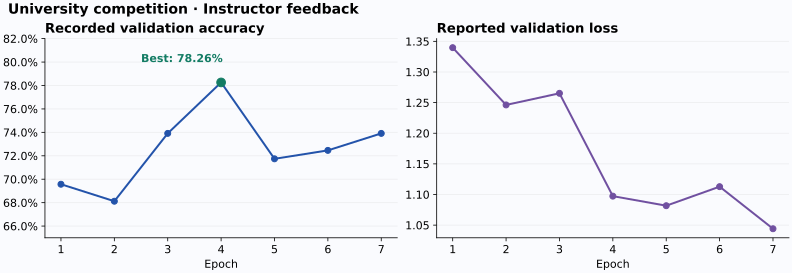
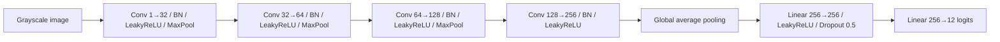

# Time-Budgeted Image Classification

**A compact convolutional neural network for a university image-classification competition, trained on CPU under a ten-minute budget.**

The project explores how augmentation, regularization and a compact architecture can work together when training time is limited. The submitted model uses four convolutional blocks and a small classification head. The supplied checkpoint has **12 output classes** and **457,676 trainable parameters**.

The instructor's recorded run reached **78.26% validation accuracy at epoch 4**. This repository preserves the submitted source and supplied weights, and provides a documented edition for training and prediction.



## Problem and approach

The course project was organized as a competition: submissions were ranked by their score on a held-out test set. The implementation targeted a CPU training limit of 600 seconds. With this constraint, the design combines a modest parameter count with several ways of reducing overfitting:

- **Grayscale input and normalization:** one input channel, normalized with mean and standard deviation 0.5.
- **Data augmentation:** brightness/contrast changes, rotation, affine transformations, perspective changes, horizontal flips and random erasing.
- **Regularization:** batch normalization, dropout, AdamW weight decay and label smoothing.
- **Compact feature aggregation:** global average pooling avoids a large fully connected layer tied to the input resolution.
- **Validation monitoring:** performance is measured after each training epoch, including a partially completed final epoch if the budget expires.

These choices were implemented together. No controlled ablation was supplied, so the results do not establish the individual benefit of each component.

## Architecture



All convolutions use 3×3 kernels with padding 1. The first three blocks use 2×2 max pooling. Training uses cross-entropy with label smoothing 0.03 and AdamW with initial learning rate 0.001 and weight decay 0.01.

## Recorded results

| Epoch | Validation accuracy | Reported average validation loss |
| --- | ---: | ---: |
| 1 | 69.57% | 1.3397 |
| 2 | 68.12% | 1.2462 |
| 3 | 73.91% | 1.2652 |
| **4** | **78.26%** | **1.0973** |
| 5 | 71.74% | 1.0817 |
| 6 | 72.46% | 1.1128 |
| 7 | 73.91% | 1.0441 |

The feedback reports that the time limit was reached before the epoch-7 validation result. Accuracy peaked before the lowest reported loss; the implementation therefore selects checkpoints by validation accuracy.

**Evidence and scope.** These values are transcribed from instructor feedback supplied with the project, rather than a new experiment. The feedback reports validation accuracy; it does not establish the hidden-test score or exact leaderboard position. The original dataset, class-name mapping and competition ranking are not included. The 12-class count is verified from the checkpoint's output layer. The weights load successfully into the submitted architecture, but their correspondence to the epoch-4 result cannot be established from the available artifacts.

## Repository guide

| Path | Purpose |
| --- | --- |
| `model.py` | Submitted architecture, extracted into an importable module; safe checkpoint loading |
| `train.py` | Configurable CPU training, validation, metrics and best-checkpoint persistence |
| `predict.py` | Single-image prediction with optional class-name mapping |
| `checkpoints/best_model.pth` | Original supplied weights, preserved byte for byte |
| `archive/original_training.py` | Original submitted source, preserved byte for byte |
| `results/validation_history.csv` | Recorded instructor feedback |
| `docs/provenance.md` | Artifact checksums, evidence and changes in the documented edition |
| `tests/test_project.py` | Checkpoint, class mapping and training/prediction checks |

## Run locally

The documented edition was checked with Python 3.12, PyTorch 2.14.1 and torchvision 0.29.1 on CPU. Use a virtual environment:

```bash
python3 -m venv .venv
source .venv/bin/activate
python -m pip install -r requirements.txt
```

### Predict with the supplied checkpoint

```bash
python predict.py path/to/image.png --checkpoint checkpoints/best_model.pth
```

The output is JSON containing sorted softmax probabilities and class indices. Without the original class mapping, labels are explicitly displayed as `class_0` through `class_11`. These indices are not semantic predictions such as a named object category. Softmax values are not calibrated confidence estimates.

If the original mapping is recovered, put its 12 names in a JSON list **in the exact training class-index order**, then pass `--classes classes.json`. Do not derive this order from a different dataset. The original code did not resize images; use the original preprocessing and image dimensions when they are available.

### Train on an ImageFolder dataset

Provide separate training and validation folders with identical class names. Keep any test split separate from training and checkpoint selection:

```text
data/
├── train/
│   ├── class_a/*.png
│   └── class_b/*.png
└── validation/
    ├── class_a/*.png
    └── class_b/*.png
```

```bash
python train.py --data-dir data --output runs/experiment-01 --time-budget 600
python predict.py path/to/image.png --checkpoint runs/experiment-01/best.pth
```

`ImageFolder` sorts class names alphabetically. New checkpoints store this mapping alongside the weights, best epoch, validation accuracy and optional resize setting. Each run writes `config.json`, `metrics.csv` and `best.pth` to a new output directory; an existing directory is rejected to protect previous results.

All images in a batch must have the same dimensions. For a new dataset with mixed image sizes, specify `--image-size 64` or another suitable size of at least 16 pixels. This is an explicit preprocessing choice, not a claim about the original competition's input size. Disable horizontal flips with `--no-horizontal-flip` if mirroring changes the meaning of a class. Other transformations should also be reviewed for the dataset's label semantics.

Defaults retain CPU execution, batch size 32, seed 123 and the submitted augmentation settings. Additional options include `--epochs`, `--workers` and `--threads`. The time limit is checked before training batches; a batch already in progress and final validation can finish after the deadline. It is a training-loop budget, not a hard process timeout.

## Documented edition

The architecture and original artifacts are preserved. The runnable edition corrects two issues in the submitted training loop: it saves an independent snapshot immediately when validation accuracy improves, and it feeds validation loss to the learning-rate scheduler. It also checks class mappings, removes an unused 1,000-image training subset and records metrics weighted by sample count.

These corrections improve execution and checkpoint reliability. **The historical 78.26% result is attributed to the recorded submission, not to a rerun of this edition.** The competition data would be required to reproduce or compare performance.

## Verification

```bash
python -m pip install -r requirements-dev.txt
python -m pytest -q
```

Checks cover compatibility with the supplied 12-class checkpoint, finite model outputs, independent best-checkpoint storage, class-order validation, rejection of a zero time budget, and a short training-to-prediction run on generated two-class images. Generated images validate the execution path; their scores are not evidence of competition performance.

## Academic context

Developed as a team project for a deep learning course at **Universitat Politècnica de Catalunya (UPC)**. This portfolio edition focuses on the project, its implementation and recorded outcomes. The original data and private correspondence are not redistributed. No open-source license has been added on behalf of the project team.
